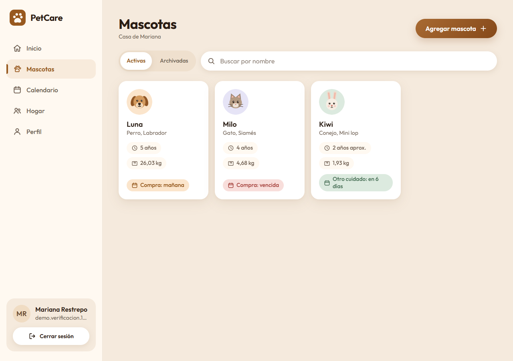
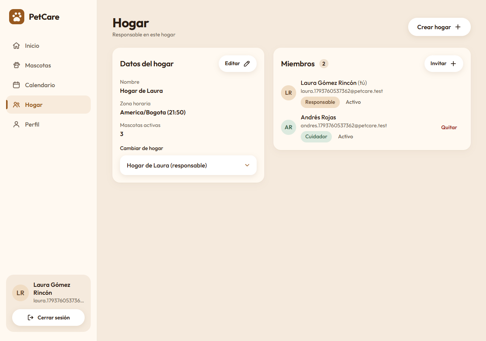
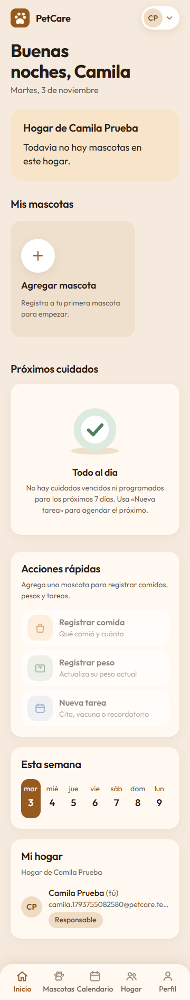
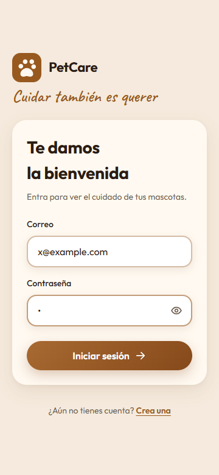
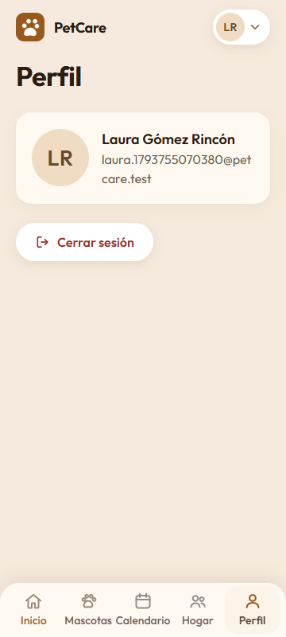
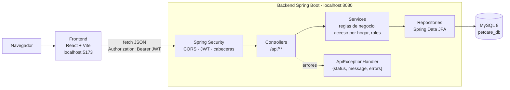
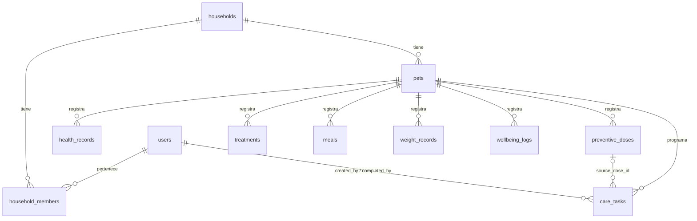

# PetCare

PetCare organiza el cuidado de las mascotas de un **hogar compartido**. Una persona crea su hogar, invita a otras como cuidadoras y entre todas llevan la ficha de cada mascota, su historial de salud, los registros diarios y un calendario de cuidados.

La aplicación está en español de Colombia y funciona en celular, tablet y escritorio.

| Inicio (escritorio) | Inicio (celular) |
|---|---|
|  |  |

## Contenido

1. [El problema y el alcance](#1-el-problema-y-el-alcance)
2. [Funcionalidades](#2-funcionalidades)
3. [Stack](#3-stack)
4. [Arquitectura](#4-arquitectura)
5. [Modelo de datos](#5-modelo-de-datos)
6. [Endpoints](#6-endpoints)
7. [Seguridad](#7-seguridad)
8. [Pruebas](#8-pruebas)
9. [Cómo ejecutar (Windows)](#9-cómo-ejecutar-windows)
10. [Scripts de desarrollo](#10-scripts-de-desarrollo)
11. [Solución de problemas](#11-solución-de-problemas)
12. [Convenciones de Git](#12-convenciones-de-git)
13. [Próximos pasos](#13-próximos-pasos)
14. [Créditos y licencias](#14-créditos-y-licencias)

---

## 1. El problema y el alcance

**El problema.** Cuando varias personas cuidan las mismas mascotas (pareja, familia, compañeros de casa), la información queda repartida: quién le dio de comer, cuándo toca la próxima vacuna, cuánto pesaba el mes pasado, qué dijo la veterinaria. Se pierden dosis, se duplican comidas y nadie tiene el historial completo.

**La solución.** Un solo lugar por hogar, compartido entre sus miembros, donde se registra y se consulta todo lo de cada mascota.

**Alcance:**

- **Registro y seguimiento, no diagnóstico.** PetCare guarda lo que las personas anotan (consultas, vacunas, tratamientos, comidas, peso, bienestar) y recuerda lo pendiente. **No usa IA ni da recomendaciones médicas.**
- **Hogares compartidos.** Cada hogar tiene un OWNER (dueño) y cuidadores (CAREGIVER) invitados. Una persona puede pertenecer a varios hogares.
- **De 1 a 10 mascotas por hogar.** Es el uso para el que se diseñaron las pantallas (tarjetas del Inicio, calendario, selector). La API no impone un tope fijo.
- **Historial clínico sin borrado.** Los registros de salud y diarios no se eliminan: se anulan dejando quién, cuándo y por qué.

## 2. Funcionalidades

| Módulo | Qué permite |
|---|---|
| **Cuenta** | Registro (crea también el hogar propio del usuario, donde queda como OWNER), inicio de sesión, ver y editar el nombre en Perfil, cerrar sesión. |
| **Hogares** | Ver los hogares a los que pertenezco y elegir uno; crear otro hogar; editar nombre y zona horaria (OWNER); ver miembros; invitar a un usuario registrado por correo (OWNER); quitar miembros o cancelar invitaciones (OWNER). |
| **Invitaciones** | Ver invitaciones pendientes, aceptarlas o rechazarlas. |
| **Mascotas** | Listado de activas y archivadas; crear y editar ficha (nombre, especie, raza, sexo, fecha de nacimiento exacta o estimada, peso, notas); archivar y restaurar (OWNER). Una mascota archivada no se edita ni recibe registros. |
| **Salud** | Registros clínicos (consulta, diagnóstico, examen, cirugía, alergia, otro); vacunas y desparasitaciones con **próxima dosis** (crea automáticamente el cuidado pendiente); tratamientos. |
| **Registros diarios** | Comidas, peso (con gráfica de evolución) y bienestar (ánimo, energía, apetito). |
| **Anulación** | El OWNER anula un registro con motivo opcional; los anulados se pueden consultar con `includeVoided=true`. Al anular una dosis se cancela su cuidado de próxima dosis pendiente. |
| **Cuidados** | Cita veterinaria, vacuna, desparasitación, medicación, peluquería, compra y otros. Crear, editar, **marcar como hecho**, cancelar y reprogramar. |
| **Calendario** | Vista de mes y de semana con los cuidados del hogar, con filtro por rango de fechas. |
| **Inicio (panel)** | Saludo, selector de hogar, resumen, tarjetas de mascotas con último peso y próximo cuidado, "Próximos cuidados" ("Hoy", "En 3 días", "Vencida"), actividad reciente y estados vacíos ilustrados. |
| **Línea de tiempo** | Historia de cada mascota, filtrable por fechas y tipos. |

Las fechas relativas ("Hoy", "Vencida", la semana) se calculan con la **zona horaria del hogar** (por defecto `America/Bogota`).

### Capturas

| Mascotas | Ficha: peso |
|---|---|
|  |  |

| Calendario | Hogar |
|---|---|
|  |  |

| Inicio vacío (celular) | Ingreso (celular) | Perfil (celular) |
|---|---|---|
|  |  |  |

Todas las capturas (360, 440, 768 y 1280 px) están en [`docs/design/screenshots/`](docs/design/screenshots/). El sistema visual está en [`docs/design/sistema-visual.md`](docs/design/sistema-visual.md).

### Demo

> **Cuenta demo**
>
> **Correo:** `demo2@petcare.example`
> **Contraseña:** `qwerty123`
>
> ⚠ Cuenta pública de demostración con datos ficticios. No guardes información real.

La cuenta existe en la base donde se generó la demo, con el frontend en `http://localhost:5173` y el backend en `http://localhost:8080`.

**Crearla en tu propia base.** Con el backend corriendo (ver [paso 6](#paso-6-datos-de-demostración-seed-demomjs)), desde la raíz del repositorio:

```powershell
$env:PETCARE_DEMO_EMAIL = "demo2@petcare.example"
$env:PETCARE_DEMO_PASSWORD = "<contraseña para la demo>"
node scripts/seed-demo.mjs
```

El script crea por la API el hogar «Casa de Mariana» con Luna, Milo y Kiwi y unos 2 meses de registros. Si el correo ya existe, se detiene sin tocar nada.

**Qué probar:**

- **Inicio:** resumen del hogar y «Próximos cuidados» con «Hoy», «En 3 días» y «Vencida».
- **Ficha de Milo:** la historia de su otitis (consulta, tratamiento con gotas óticas, bienestar que baja y se recupera), su peso y sus cuidados pendientes.
- **Calendario:** vistas de mes y semana; marca un cuidado como hecho o reprográmalo.
- **Hogar:** nombre, zona horaria y miembros (como OWNER, invitar y quitar).
- **Perfil:** ver y editar el nombre; cerrar sesión.

## 3. Stack

| Capa | Tecnología | Versión |
|---|---|---|
| Lenguaje backend | Java | 21 |
| Framework | Spring Boot (Web MVC, Validation, Data JPA / Hibernate) | 4.1.1 |
| Seguridad | Spring Security, OAuth2 Resource Server (JWT HS256 con Nimbus), Argon2id (Bouncy Castle) | la que trae Spring Boot 4.1 |
| Base de datos | MySQL (scripts SQL versionados, `ddl-auto=none`) | 8 |
| Build | Maven (wrapper `mvnw.cmd` incluido) | — |
| Documentación de la API | springdoc-openapi (Swagger UI, solo fuera de `prod`) | — |
| Frontend | React + React DOM | ^19.3.1 |
| Enrutamiento | react-router-dom (única dependencia extra) | ^7.18.5 |
| Bundler | Vite + @vitejs/plugin-react | ^8.3.5 / ^6.2.1 |
| Estilos | CSS propio con variables. Sin Tailwind, sin librerías de UI, sin CDN | — |
| Pruebas | JUnit 5 + Mockito + AssertJ, Postman, Playwright | — |

## 4. Arquitectura



- **Backend:** organizado por funcionalidad. Cada módulo sigue Controller → Service → Repository; los controladores nunca usan repositorios directamente. Los DTOs son `record` y las validaciones responden en español.
- **Frontend:** un solo cliente HTTP (`src/api/client.js`) añade el token y normaliza los errores del backend a `{status, message, errors}`. Un 401 cierra la sesión y lleva a `/login`.

### Estructura de carpetas

```
PetCare/
├── backend/                 API REST (Spring Boot)
│   └── src/main/java/com/petcare/backend/
│       ├── auth/            registro, login, JWT, límite de intentos
│       ├── users/           /api/users/me
│       ├── households/      hogares, miembros, invitaciones, acceso por hogar, zona horaria
│       ├── pets/            mascotas (activas y archivadas)
│       ├── records/         salud, dosis, tratamientos, comidas, pesos, bienestar (con anulación)
│       ├── tasks/           cuidados de cada mascota y del hogar
│       ├── dashboard/       panel del hogar
│       ├── timeline/        línea de tiempo de la mascota
│       ├── health/          /api/health
│       ├── common/          errores en JSON, usuario actual, utilidades
│       └── config/          seguridad, CORS, OpenAPI
├── frontend/                SPA (React + Vite)
│   └── src/
│       ├── api/             cliente fetch y servicios por recurso
│       ├── auth/            sesión (AuthContext) y rutas protegidas
│       ├── households/      hogar elegido, rol y zona horaria
│       ├── components/      componentes base (Button, Input, Modal, Tabs…)
│       ├── pages/           Inicio, Mascotas y ficha, Calendario, Hogar, Perfil, Login, Registro
│       ├── i18n/            traducción de los valores del backend (labels.js)
│       ├── assets/          fuentes locales e íconos SVG propios
│       └── styles/          tokens y estilos
├── database/                scripts SQL en orden (01 → 05) y limpieza de desarrollo
├── docs/
│   ├── postman/             colección y entorno de Postman
│   └── design/              sistema visual, referencia, crítica y capturas
└── scripts/                 seed-demo.mjs (cuenta de demostración)
```

Rutas del frontend: `/login`, `/register`, `/` (Inicio), `/mascotas`, `/mascotas/:id`, `/calendario`, `/hogar`, `/perfil`. Cualquier otra ruta redirige a `/`.

## 5. Modelo de datos



| Tabla | Contenido | Valores de estado |
|---|---|---|
| `users` | nombre, correo único, `password_hash` (nunca se expone) | `ACTIVE`, `INACTIVE` |
| `households` | nombre y zona horaria (`America/Bogota` por defecto) | — |
| `household_members` | usuario ↔ hogar con rol; único por (hogar, usuario) | rol `OWNER`/`CAREGIVER`; estado `ACTIVE`/`INVITED`/`INACTIVE` |
| `pets` | ficha de la mascota; pertenece a un hogar | `ACTIVE`, `ARCHIVED`; sexo `MALE`/`FEMALE`/`UNKNOWN` |
| `health_records` | consulta, diagnóstico, examen, cirugía, alergia, otro | `ACTIVE`, `VOIDED` |
| `preventive_doses` | vacuna o desparasitación, con próxima dosis | `ACTIVE`, `VOIDED` |
| `treatments` | tratamientos | `ACTIVE`, `VOIDED` |
| `meals` | comidas | `ACTIVE`, `VOIDED` |
| `weight_records` | pesos | `ACTIVE`, `VOIDED` |
| `wellbeing_logs` | ánimo (5 niveles), energía y apetito (`LOW`/`NORMAL`/`HIGH`) | `ACTIVE`, `VOIDED` |
| `care_tasks` | cuidados programados (cita, vacuna, desparasitación, medicación, peluquería, compra, otro) | `PENDING`, `COMPLETED`, `CANCELLED` |

Todos los registros de salud y diarios guardan `created_by` (FK a `users`) y `created_at`; al anularse, `voided_by` (FK a `users`), `voided_at` y `void_reason`.

### Migraciones

| Orden | Script | Contenido |
|---|---|---|
| 01 | `01_schema.sql` | Crea la base `petcare_db` y las tablas `users`, `households`, `household_members`, `pets` |
| 02 | `02_health_records.sql` | `health_records`, `preventive_doses`, `treatments`, `meals`, `weight_records`, `wellbeing_logs` |
| 03 | `03_care_tasks.sql` | `care_tasks` |
| 04 | `04_void_records.sql` | Agrega `voided_by`, `voided_at` y `void_reason` a las seis tablas de registros |
| 05 | `05_task_source.sql` | Agrega `care_tasks.source_dose_id` (cuidado generado por una dosis) |

La aplicación no crea ni modifica tablas (`spring.jpa.hibernate.ddl-auto=none`). Cada cambio de esquema va en un script nuevo numerado; los existentes no se modifican.

## 6. Endpoints

Todos requieren `Authorization: Bearer <token>` salvo los marcados como públicos. **Miembro** = miembro `ACTIVE` del hogar del recurso (OWNER o CAREGIVER).

Códigos comunes a todos los endpoints protegidos: **401** sin token o con token inválido; **404** si el recurso no existe **o es de otro hogar**; **400** con `errors` por campo si la validación falla.

| Método | Ruta | Quién | Respuestas |
|---|---|---|---|
| GET | `/api/health` | Público | 200 |
| POST | `/api/auth/register` | Público | 201, 400, 409 (correo ya registrado) |
| POST | `/api/auth/login` | Público | 200 (JWT), 400, 401, 429 (`Retry-After`) |
| GET | `/api/users/me` | Autenticado | 200 |
| PUT | `/api/users/me` | Autenticado (solo `fullName`) | 200, 400 |
| GET | `/api/households` | Autenticado (mis hogares) | 200 |
| POST | `/api/households` | Autenticado (queda como OWNER) | 201, 400 |
| PUT | `/api/households/{id}` | OWNER | 200, 400 (zona horaria inválida), 403, 404 |
| GET | `/api/households/{id}/members` | Miembro | 200, 404 |
| POST | `/api/households/{id}/invitations` | OWNER | 201, 400, 403, 404, 409 (ya es miembro o ya tiene invitación) |
| DELETE | `/api/households/{id}/members/{userId}` | OWNER (quita o cancela invitación) | 204, 403, 404, 409 (el OWNER no se quita a sí mismo) |
| GET | `/api/invitations` | Autenticado (mis invitaciones pendientes) | 200 |
| POST | `/api/invitations/{householdId}/accept` | Invitado | 200, 404 |
| POST | `/api/invitations/{householdId}/decline` | Invitado | 204, 404 |
| GET | `/api/pets?householdId=&status=ACTIVE\|ARCHIVED` | Miembro | 200, 400, 404 |
| POST | `/api/pets` | Miembro (`householdId` opcional: si falta, el hogar donde soy OWNER) | 201, 400, 404 |
| GET | `/api/pets/{id}` | Miembro | 200, 404 |
| PUT | `/api/pets/{id}` | Miembro | 200, 400, 404, 409 (archivada) |
| PATCH | `/api/pets/{id}/archive` | OWNER | 200, 403, 404 |
| PATCH | `/api/pets/{id}/restore` | OWNER | 200, 403, 404 |
| GET | `/api/pets/{petId}/{tipo}?includeVoided=true` | Miembro | 200, 404 |
| POST | `/api/pets/{petId}/{tipo}` | Miembro | 201, 400, 404, 409 (mascota archivada) |
| PATCH | `/api/pets/{petId}/{tipo}/{id}/void` | OWNER (cuerpo opcional `{reason}`) | 200, 403, 404, 409 (ya anulado) |
| GET | `/api/pets/{petId}/tasks?status=PENDING\|COMPLETED\|CANCELLED` | Miembro | 200, 400, 404 |
| POST | `/api/pets/{petId}/tasks` | Miembro | 201, 400, 404, 409 |
| PUT | `/api/pets/{petId}/tasks/{id}` | Miembro (solo `PENDING`) | 200, 400, 404, 409 |
| PATCH | `/api/pets/{petId}/tasks/{id}/complete` | Miembro (cuerpo opcional) | 200, 400, 404, 409 |
| PATCH | `/api/pets/{petId}/tasks/{id}/cancel` | Miembro | 200, 404, 409 |
| PATCH | `/api/pets/{petId}/tasks/{id}/reschedule` | Miembro | 200, 400, 404, 409 |
| GET | `/api/households/{id}/tasks?range=upcoming\|overdue\|all&days=` o `?from=&to=` (AAAA-MM-DD, máx. 366 días) | Miembro | 200, 400, 404 |
| GET | `/api/households/{id}/dashboard` | Miembro | 200, 404 |
| GET | `/api/pets/{petId}/timeline?from=&to=&types=` | Miembro | 200, 400, 404 |

`{tipo}` es uno de: `health-records`, `doses`, `treatments`, `meals`, `weights`, `wellbeing`.

Formato de error (en español): `{"status": 404, "message": "…"}`; los de validación incluyen `errors` por campo. Con el backend en desarrollo, Swagger UI está en `http://localhost:8080/swagger-ui.html`.

## 7. Seguridad

- **JWT HS256.** Firmado y verificado con Nimbus. La clave llega por `JWT_SECRET` (Base64, mínimo 32 bytes; si no es válida la app no arranca) y el token dura **1 hora**. La API es sin estado: no usa sesión ni cookies, y por eso CSRF está desactivado. En el navegador el token vive en `sessionStorage`: se borra al cerrar la pestaña, pero un ataque XSS podría leerlo; por eso el frontend nunca inserta HTML de usuario.
- **Argon2id con rehash desde BCrypt.** `DelegatingPasswordEncoder` guarda `{argon2}$argon2id$…`. Los hashes BCrypt antiguos siguen validando y, en el siguiente login correcto, se re-cifran con Argon2id (`upgradeEncoding`). Ningún endpoint devuelve el hash: las respuestas usan DTOs (`UserResponse`, `MemberResponse`) y además el campo tiene `@JsonIgnore`.
- **Login genérico.** Correo inexistente y contraseña incorrecta dan el mismo mensaje y tardan parecido (se verifica contra un hash de relleno).
- **Límite de intentos de login.** Tras **5 fallos por correo en 15 minutos** la API responde **429** con `Retry-After`. Es en memoria, pensado para una sola instancia.
- **Anti-IDOR: 404 en lugar de 403.** Cada consulta comprueba que el usuario sea miembro `ACTIVE` del hogar del recurso. Un recurso de otro hogar responde **404 con el mismo mensaje que uno inexistente**, para no revelar qué ids existen. El 403 solo aparece cuando el usuario sí es miembro pero su rol no alcanza.
- **Roles OWNER / CAREGIVER.** Ambos registran, editan mascotas y gestionan cuidados. Solo el OWNER edita el hogar, invita y quita miembros, archiva y restaura mascotas y anula registros (403 para un CAREGIVER). La interfaz oculta esas acciones según el rol.
- **Anulación con trazabilidad.** Los registros de salud y diarios nunca se borran: se anulan (`status = VOIDED`) guardando `voided_by`, `voided_at` y `void_reason`. Todos guardan `created_by` y `created_at`.
- **CORS restringido.** Solo los orígenes de `petcare.cors.allowed-origins` (en desarrollo `http://localhost:5173`; en `prod`, `PETCARE_CORS_ALLOWED_ORIGINS`). Métodos `GET, POST, PUT, PATCH, DELETE`; cabeceras `Authorization` y `Content-Type`; expone `Location` y `Retry-After`; sin credenciales por cookie.
- **Cabeceras.** `X-Content-Type-Options: nosniff`, `X-Frame-Options: DENY`, `Content-Security-Policy: frame-ancestors 'none'`, `Referrer-Policy: strict-origin-when-cross-origin`, `Cache-Control: no-store` y HSTS en HTTPS.
- **Sin divulgación de detalles.** Los 500 responden un mensaje genérico (sin stack trace); el detalle queda en el log. `/api/health` devuelve solo `status` y `timestamp`. Swagger está desactivado en `prod`.
- **Secretos fuera del repositorio.** Solo variables de entorno; `.env*` y `*.local.md` están en `.gitignore`.

## 8. Pruebas

### JUnit (backend)

**75 pruebas unitarias** (JUnit 5 + Mockito + AssertJ), sin base de datos:

| Clase | Pruebas |
|---|---|
| `CareTaskServiceTest` | 25 |
| `PetServiceTest` | 12 |
| `AuthServiceTest` | 11 |
| `HouseholdAccessServiceTest` | 11 |
| `LoginAttemptServiceTest` | 6 |
| `HouseholdServiceTest` | 4 |
| `PetRecordServiceTest` | 4 |
| `UserServiceTest` | 2 |

```powershell
cd backend
.\mvnw.cmd test
```

Además hay **1 prueba de integración** (`BackendApplicationTests`, `@Tag("integration")`) que levanta el contexto completo; necesita MySQL y las variables de entorno, por eso Maven la excluye por defecto:

```powershell
.\mvnw.cmd test "-Dintegration.tests.excluded=none"
```

### Postman

`docs/postman/PetCare API.postman_collection.json` tiene **171 peticiones con 380 pruebas `pm.test`** en español, en las carpetas Health, Auth, Pets, Households, Invitations, Health & Care, Tasks & Dashboard, Security (IDOR) y Rate limit. Cubre casos negativos (400, 401, 403, 404, 409, 429) y encadena variables (`token`, `householdId`, `petId`…). Está pensada para correr completa y en orden con el Collection Runner; cada ejecución crea usuarios nuevos con correo `@petcare.test`.

### Playwright (frontend)

La interfaz se verificó con Playwright (MCP) contra el backend local: registro de un correo de prueba único, inicio de sesión, recorrido por las pantallas y capturas a 360, 768 y 1280 px (y 440 px en algunas), comparadas con la referencia de `docs/design/`. Las capturas finales están en `docs/design/screenshots/`. Además, `npm run build` debe terminar sin errores.

## 9. Cómo ejecutar (Windows)

### Requisitos

- JDK 21
- MySQL 8 con MySQL Workbench (o el cliente `mysql`)
- Node 18 o superior (el script de demo usa `fetch` nativo)
- Postman (opcional, para la colección)
- IntelliJ IDEA (opcional, para correr el backend)

### Paso 1. Crear la base de datos (con root)

Conéctate en Workbench **con root** (o un usuario con permisos de DDL) y ejecuta los scripts de `database/` **en orden**: `01_schema.sql` → `02_health_records.sql` → `03_care_tasks.sql` → `04_void_records.sql` → `05_task_source.sql`.

### Paso 2. Crear el usuario de la aplicación

Todavía con root, crea `petcare_app` con **tu propia contraseña** y solo permisos de datos:

```sql
CREATE USER 'petcare_app'@'localhost' IDENTIFIED BY '<tu-contraseña>';
GRANT SELECT, INSERT, UPDATE, DELETE ON petcare_db.* TO 'petcare_app'@'localhost';
```

`petcare_app` no puede crear ni alterar tablas: los scripts de esquema siempre van con root.

### Paso 3. Variables de entorno

Ningún valor real va en el repositorio.

| Variable | Dónde | Obligatoria | Descripción |
|---|---|---|---|
| `SPRING_DATASOURCE_PASSWORD` | backend | Sí | Contraseña de `petcare_app` (también se acepta `DB_PASSWORD`) |
| `JWT_SECRET` | backend | Sí | Clave HS256 en Base64, mínimo 32 bytes aleatorios |
| `SPRING_PROFILES_ACTIVE` | backend | No | `prod` para el perfil de producción |
| `PETCARE_CORS_ALLOWED_ORIGINS` | backend | En `prod` | Orígenes del frontend separados por comas |
| `SPRING_DATASOURCE_URL` | backend | No | Otra URL distinta de `jdbc:mysql://localhost:3306/petcare_db` |
| `VITE_API_URL` | frontend | No | URL del backend (por defecto `http://localhost:8080`); ver `frontend/.env.example` |
| `PETCARE_DEMO_PASSWORD` | seed-demo | Sí | Contraseña de la cuenta demo (8 a 128 caracteres) |
| `PETCARE_DEMO_EMAIL` | seed-demo | No | Correo de la demo (por defecto `demo@petcare.example`) |
| `PETCARE_API_URL` | seed-demo | No | URL del backend para el script (por defecto `http://localhost:8080`) |

Generar `JWT_SECRET` en PowerShell:

```powershell
$bytes = New-Object byte[] 32
[Security.Cryptography.RandomNumberGenerator]::Create().GetBytes($bytes)
[Convert]::ToBase64String($bytes)
```

**En IntelliJ:** *Run → Edit Configurations… → BackendApplication → Environment variables*, las dos en una sola línea separadas por `;`:

```
SPRING_DATASOURCE_PASSWORD=<contraseña de petcare_app>;JWT_SECRET=<clave Base64>
```

**En PowerShell** (solo para esa ventana):

```powershell
$env:SPRING_DATASOURCE_PASSWORD = "<contraseña de petcare_app>"
$env:JWT_SECRET = "<clave Base64>"
```

### Paso 4. Backend

```powershell
cd backend
.\mvnw.cmd spring-boot:run
```

O ejecuta `BackendApplication` desde IntelliJ. La API queda en `http://localhost:8080`; compruébala con `GET http://localhost:8080/api/health`. Swagger UI: `http://localhost:8080/swagger-ui.html`.

### Paso 5. Frontend

```powershell
cd frontend
npm install
npm run dev        # http://localhost:5173
npm run build      # versión de producción en frontend/dist
```

Vite usa el puerto 5173 con `strictPort`: si está ocupado, falla en lugar de cambiar de puerto (el backend solo acepta CORS desde 5173). Las fuentes e íconos están en el repositorio; no se carga nada desde CDN. En producción, el servidor que publique `dist/` debe enviar sus propias cabeceras de seguridad (CSP, `frame-ancestors`, HSTS).

### Paso 6. Datos de demostración (`seed-demo.mjs`)

Con el backend corriendo, desde la raíz del repositorio:

```powershell
$env:PETCARE_DEMO_PASSWORD = "<contraseña para la demo>"
$env:PETCARE_DEMO_EMAIL = "<correo de la demo>"   # opcional
node scripts/seed-demo.mjs
```

Crea, solo a través de la API, una cuenta con el hogar «Casa de Mariana», 3 mascotas (Luna, Milo y Kiwi) y unos 2 meses de pesos, comidas, bienestar, vacunas, un tratamiento, consultas y cuidados. Si el correo ya existe, se detiene sin modificar nada.

### Paso 7. Postman

1. Importa `docs/postman/PetCare API.postman_collection.json` y `docs/postman/PetCare Local.postman_environment.json`.
2. Elige el entorno **PetCare Local** (`baseUrl = http://localhost:8080`).
3. Ejecuta la colección completa **en orden** con el Collection Runner.

## 10. Scripts de desarrollo

### Respaldo con `mysqldump`

Antes de cualquier limpieza, saca un respaldo. En PowerShell (ajusta la ruta si tu versión de MySQL es otra):

```powershell
& "C:\Program Files\MySQL\MySQL Server 8.0\bin\mysqldump.exe" -u root -p --routines --single-transaction --databases petcare_db --result-file="petcare_db_respaldo.sql"
```

`-p` sin valor hace que pida la contraseña (no queda en el historial). `--result-file` evita que la redirección `>` de PowerShell guarde el archivo en UTF-16. No subas el respaldo al repositorio.

### Limpieza de usuarios de prueba (`dev_cleanup_test_users.sql`)

**Solo para desarrollo.** Borra físicamente los usuarios con correo `@petcare.test` (los que crean Postman y las verificaciones) y sus datos; conserva los hogares donde haya algún miembro real.

1. Haz el respaldo anterior.
2. Conéctate **con root** (el script crea tablas temporales y `petcare_app` no tiene ese permiso).
3. Ejecuta el script completo. Corre dentro de `START TRANSACTION` y **no confirma solo**: el `COMMIT` final está comentado (`-- COMMIT;`), así que la transacción queda abierta.
4. Revisa la **vista previa** (el primer resultado muestra cuántas filas se borrarán por tabla) y comprueba qué usuarios quedan con `SELECT email FROM users;`.
5. En la **misma pestaña** de Workbench, ejecuta a mano `COMMIT;` para aplicar o `ROLLBACK;` para deshacer. Si cierras la conexión sin `COMMIT`, MySQL deshace los cambios.

## 11. Solución de problemas

| Síntoma | Causa | Solución |
|---|---|---|
| El backend no arranca: `Could not resolve placeholder 'JWT_SECRET'` | Falta la variable `JWT_SECRET` | Defínela (paso 3). En IntelliJ, revisa que esté en la configuración que ejecutas y separada por `;` de la otra variable. |
| El backend no arranca: `JWT_SECRET no es un texto Base64 válido` o clave de menos de 32 bytes | Clave mal generada | Genérala con el comando de PowerShell del paso 3. |
| En Workbench: `CREATE command denied`, `ALTER command denied` o error al ejecutar la limpieza | La conexión es con `petcare_app`, que solo tiene `SELECT, INSERT, UPDATE, DELETE` | Ejecuta los scripts de `database/` con una conexión **root**. |
| Workbench, *Server → Data Export*: `Unhandled exception: cannot access local variable 'pwd' where it is not associated with a value` | Fallo de MySQL Workbench cuando la conexión no tiene la contraseña guardada | Guarda la contraseña con **Store in Vault…** en la conexión de root, o exporta con `mysqldump` desde PowerShell con `-u root -p` y `--result-file` (sección 10). |
| Workbench, *Data Export* con `petcare_app`: `Access denied … LOCK TABLES` | `petcare_app` no tiene el permiso `LOCK TABLES` que usa la exportación | Exporta con **root**. |
| El frontend carga pero las peticiones fallan por CORS | Vite corre en otro puerto o se abrió `127.0.0.1` en lugar de `localhost` | Abre `http://localhost:5173`. Si el puerto está ocupado, cierra el otro proceso; para otro origen, ajusta `petcare.cors.allowed-origins`. |
| Postman falla en peticiones nuevas o con variables que no existen | Postman no sincroniza el archivo del repositorio: quedó con una versión vieja de la colección | Vuelve a importar `PetCare API.postman_collection.json` (reemplazar) y el entorno, y corre la colección completa en orden. |
| Postman: 429 en los login | Se alcanzó el límite de 5 intentos en 15 minutos (la carpeta Rate limit lo provoca a propósito) | Espera el `Retry-After` o reinicia el backend (el límite está en memoria). |
| Playwright MCP muestra en Chrome el aviso `--disable-blink-features=AutomationControlled` | Es una bandera que agrega el navegador automatizado | Es inofensivo: no afecta la app ni las capturas. |
| La sesión se cierra sola | El JWT dura 1 hora, o se cerró la pestaña (`sessionStorage`) | Inicia sesión de nuevo. |

## 12. Convenciones de Git

- **Commits convencionales** en español: `feat:`, `fix:`, `refactor:`, `chore:`, con ámbito cuando aplica (`feat(backend): …`, `feat(frontend): …`).
- **Tags:**
  - `v1.0-backend`: backend MVP completo.
  - `v1.0`: aplicación completa (backend y frontend).
- Ningún secreto, respaldo de base de datos ni archivo `*.local.md` se sube al repositorio.

## 13. Próximos pasos

- **Fotos de mascotas:** subida y almacenamiento de imágenes (la tabla `pets` ya tiene `photo_url`).
- **Notificaciones:** recordatorios de cuidados próximos y vencidos (correo o push).
- **Despliegue:** perfil `prod` con HTTPS, CORS y cabeceras en el servidor del frontend; límite de intentos compartido si hay varias instancias.
- **App móvil:** cliente nativo o PWA sobre la misma API.

## 14. Créditos y licencias

- **Fuentes:** [Outfit](https://github.com/Outfitio/Outfit-Fonts) (© 2021 The Outfit Project Authors) y [Caveat](https://github.com/googlefonts/caveat) (© 2014 The Caveat Project Authors), bajo la **SIL Open Font License 1.1**. Se sirven en local desde `frontend/src/assets/fonts/`, junto con sus licencias (`OFL-Outfit.txt`, `OFL-Caveat.txt`).
- **Íconos e ilustraciones:** SVG propios de PetCare en `frontend/src/assets/icons/`.
- **Dependencias:** Spring Boot, Spring Security, Hibernate, Bouncy Castle, springdoc-openapi, MySQL Connector/J, React, React Router y Vite, cada una con su propia licencia de código abierto.
