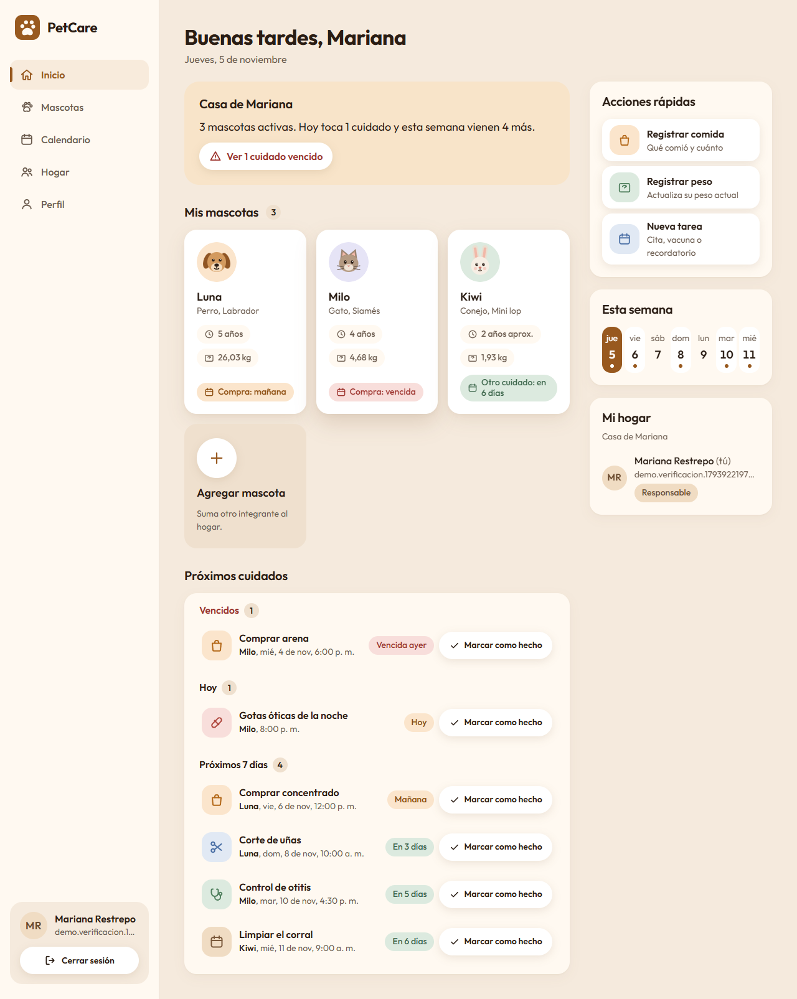
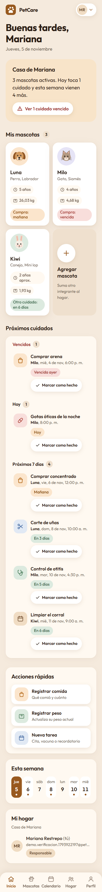
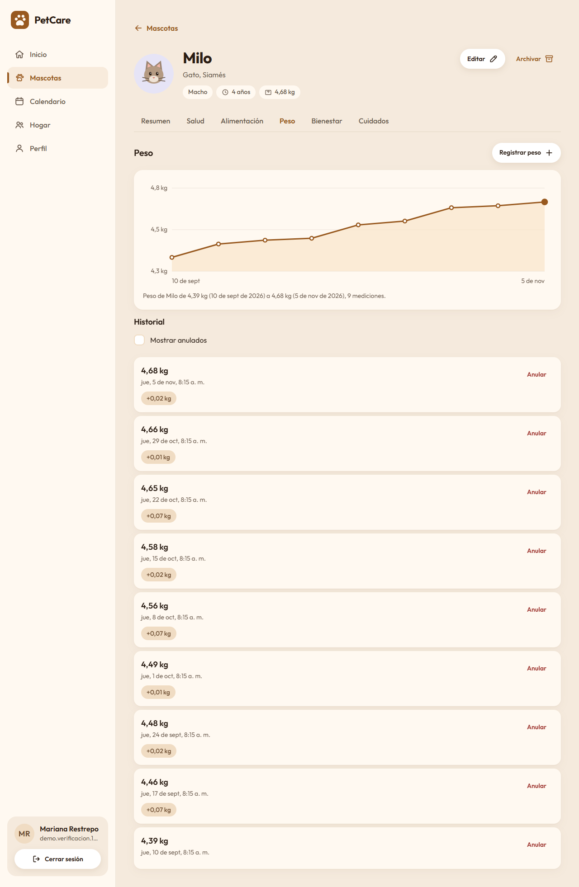
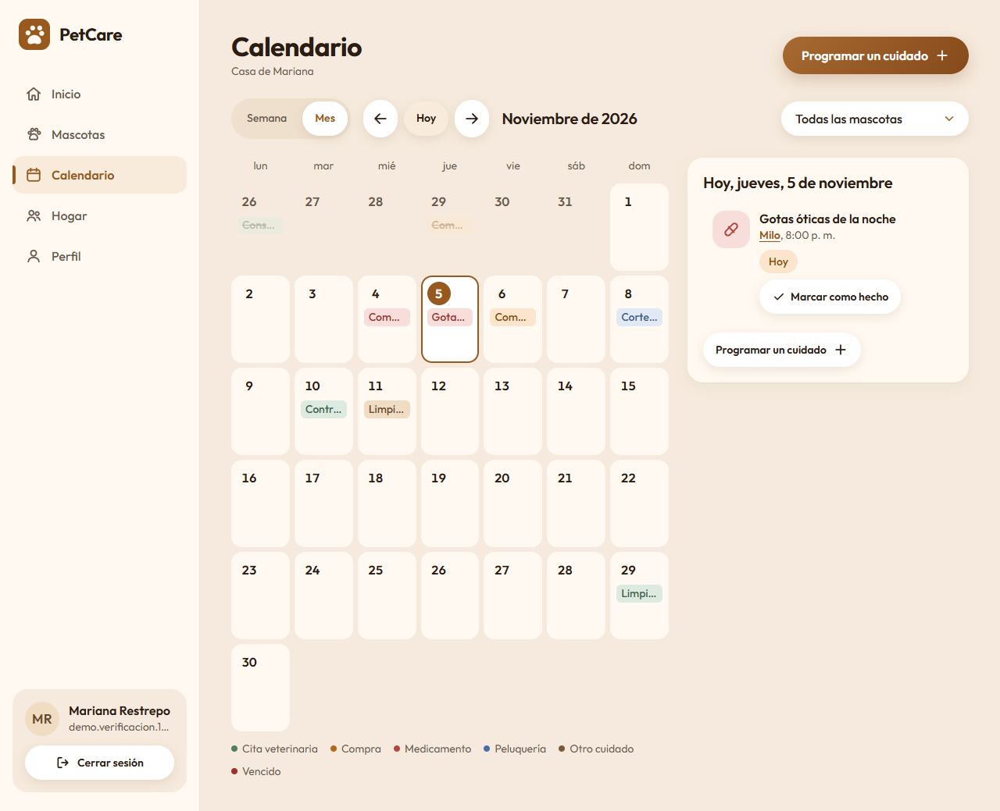

# PetCare

PetCare organiza el cuidado de las mascotas de un **hogar compartido**. Una persona crea su hogar, invita a otras como cuidadoras y entre todas llevan:

- la ficha de cada mascota (especie, raza, edad, peso);
- el historial de salud: consultas, vacunas y desparasitaciones con próxima dosis, tratamientos;
- los registros diarios: comidas, peso (con gráfica) y bienestar;
- los cuidados: citas y recordatorios en un calendario, con «Marcar como hecho».

La aplicación está en español de Colombia y funciona en celular, tablet y escritorio.

| Inicio (escritorio) | Inicio (celular) |
|---|---|
|  |  |

| Ficha de mascota: peso | Calendario |
|---|---|
|  |  |

Más capturas en [`docs/design/screenshots/`](docs/design/screenshots/). El sistema visual está en [`docs/design/sistema-visual.md`](docs/design/sistema-visual.md).

## Stack

| Capa | Tecnología |
|---|---|
| Backend | Java 21, Spring Boot 4.1 (Web MVC, Validation, Data JPA / Hibernate), Maven (wrapper incluido) |
| Seguridad | Spring Security 7, JWT HS256 (Nimbus), Argon2id con `DelegatingPasswordEncoder` |
| Base de datos | MySQL 8 (scripts SQL versionados, sin `ddl-auto`) |
| Frontend | React + Vite, JavaScript, CSS propio con variables, `react-router-dom`. Sin librerías de UI ni CDN |
| Pruebas | JUnit 5 + Mockito + AssertJ (backend), colección de Postman |
| Documentación de la API | springdoc-openapi (Swagger UI, solo en desarrollo) |

## Arquitectura

```
PetCare/
├── backend/            API REST (Spring Boot)
│   └── com.petcare.backend
│       ├── auth/        registro, login, JWT, límite de intentos
│       ├── users/       /api/users/me
│       ├── households/  hogares, miembros, invitaciones, acceso por hogar, zona horaria
│       ├── pets/        mascotas (activas y archivadas)
│       ├── records/     salud, dosis, tratamientos, comidas, pesos, bienestar (con anulación)
│       ├── tasks/       cuidados de cada mascota y del hogar
│       ├── dashboard/   panel del hogar
│       ├── timeline/    línea de tiempo de la mascota
│       ├── common/      errores en JSON, usuario actual, utilidades
│       └── config/      seguridad, CORS, OpenAPI
├── frontend/           SPA (React + Vite)
│   └── src/
│       ├── api/         cliente fetch y servicios por recurso
│       ├── auth/        sesión (AuthContext) y rutas protegidas
│       ├── households/  hogar elegido, rol y zona horaria
│       ├── components/  componentes base (Button, Input, Modal, Tabs…)
│       ├── pages/       Inicio, Mascotas y ficha, Calendario, Hogar, Perfil
│       ├── i18n/        traducción de los valores del backend
│       └── styles/      tokens y estilos
├── database/           scripts SQL en orden (01 → 05) y limpieza de desarrollo
├── docs/postman/       colección y entorno de Postman
├── docs/design/        sistema visual, crítica y capturas
└── scripts/            seed-demo.mjs (cuenta de demostración)
```

- **Backend:** organizado por funcionalidad. Cada módulo sigue Controller → Service → Repository; los controladores nunca usan repositorios directamente. Los DTOs son `record` y las validaciones responden en español.
- **Frontend:** un solo cliente HTTP (`src/api/client.js`) añade el token y normaliza los errores del backend a `{status, message, errors}`. Un 401 cierra la sesión. Las fechas relativas («Hoy», «Vencida», la semana) se calculan con la **zona horaria del hogar** usando `Intl`.

## Seguridad

- **Contraseñas con Argon2id.** `DelegatingPasswordEncoder` guarda `{argon2}$argon2id$…`. Los hashes BCrypt antiguos siguen validando y se re-cifran con Argon2id en el siguiente login correcto. Ningún endpoint devuelve el hash: las respuestas usan DTOs (`UserResponse`, `MemberResponse`) y además el campo tiene `@JsonIgnore`.
- **Login genérico y límite de intentos.** Correo inexistente y contraseña incorrecta dan el mismo mensaje, con tiempo de respuesta similar. Tras 5 fallos por correo en 15 minutos la API responde 429 con `Retry-After` (implementación en memoria, para una sola instancia).
- **JWT HS256.** Firmado con Nimbus; la clave llega por `JWT_SECRET` (Base64, mínimo 32 bytes) y dura 1 hora. La API no usa sesión ni cookies. En el navegador el token vive en `sessionStorage`: se borra al cerrar la pestaña, pero un ataque XSS podría leerlo (por eso el frontend no inserta HTML de usuario).
- **Anti-IDOR.** Cada consulta valida que el usuario sea miembro ACTIVE del hogar del recurso. Un recurso de otro hogar responde **404 con el mismo mensaje que uno inexistente**, para no revelar qué ids existen.
- **Roles.** OWNER y CAREGIVER registran, editan mascotas y completan cuidados. Solo el OWNER archiva y restaura mascotas, anula registros, edita el hogar, invita y quita miembros (403 para un CAREGIVER). La interfaz oculta esas acciones según el rol.
- **Anulación con trazabilidad.** Los registros de salud y diarios nunca se borran: se anulan (`status = VOIDED`) guardando `voided_by`, `voided_at` y un motivo opcional. Todos guardan `created_by` y `created_at`. Al anular una dosis, su cuidado de próxima dosis pendiente se cancela.
- **Cabeceras.** `X-Content-Type-Options: nosniff`, `X-Frame-Options: DENY`, `Content-Security-Policy: frame-ancestors 'none'`, `Referrer-Policy: strict-origin-when-cross-origin`, `Cache-Control: no-store` y HSTS en HTTPS.
- **CORS restringido** a los orígenes de `petcare.cors.allowed-origins` (en producción, `PETCARE_CORS_ALLOWED_ORIGINS`), sin credenciales por cookie.
- **Sin divulgación de detalles.** Los errores 500 responden un mensaje genérico; el detalle queda solo en el log. `/api/health` devuelve únicamente `status` y `timestamp`.
- **Secretos fuera del repositorio.** Solo variables de entorno.

## Variables de entorno

Ningún valor real va en el repositorio.

| Variable | Dónde | Obligatoria | Descripción |
|---|---|---|---|
| `SPRING_DATASOURCE_PASSWORD` | backend | Sí | Contraseña del usuario `petcare_app` de MySQL (también se acepta `DB_PASSWORD`) |
| `JWT_SECRET` | backend | Sí | Clave HS256 en Base64, mínimo 32 bytes aleatorios |
| `SPRING_PROFILES_ACTIVE` | backend | No | `prod` para el perfil de producción |
| `PETCARE_CORS_ALLOWED_ORIGINS` | backend | En `prod` | Orígenes del frontend separados por comas |
| `SPRING_DATASOURCE_URL` | backend | No | Otra URL de MySQL distinta de `jdbc:mysql://localhost:3306/petcare_db` |
| `VITE_API_URL` | frontend | No | URL del backend (por defecto `http://localhost:8080`); ver `frontend/.env.example` |
| `PETCARE_DEMO_PASSWORD` | seed-demo | Sí | Contraseña de la cuenta de demostración |
| `PETCARE_DEMO_EMAIL` | seed-demo | No | Correo de la cuenta demo (por defecto `demo@petcare.example`) |
| `PETCARE_API_URL` | seed-demo | No | URL del backend para el script (por defecto `http://localhost:8080`) |

Para generar `JWT_SECRET` en PowerShell:

```powershell
$bytes = New-Object byte[] 32
[Security.Cryptography.RandomNumberGenerator]::Create().GetBytes($bytes)
[Convert]::ToBase64String($bytes)
```

## Cómo ejecutar

Requisitos: JDK 21, MySQL 8 (con MySQL Workbench o el cliente `mysql`), Node 18+ y Postman.

### 1. Base de datos

Ejecuta los scripts de `database/` **en orden**:

| Orden | Script | Contenido |
|---|---|---|
| 1 | `01_schema.sql` | Base `petcare_db`; tablas `users`, `households`, `household_members`, `pets` |
| 2 | `02_health_records.sql` | `health_records`, `preventive_doses`, `treatments`, `meals`, `weight_records`, `wellbeing_logs` |
| 3 | `03_care_tasks.sql` | `care_tasks` |
| 4 | `04_void_records.sql` | Trazabilidad de la anulación: `voided_by`, `voided_at`, `void_reason` |
| 5 | `05_task_source.sql` | `care_tasks.source_dose_id` (cuidado generado por una dosis) |

La aplicación no crea ni modifica tablas (`spring.jpa.hibernate.ddl-auto=none`). Cada cambio de esquema va en un script nuevo numerado. Crea el usuario de la aplicación con tu propia contraseña:

```sql
CREATE USER 'petcare_app'@'localhost' IDENTIFIED BY '<tu-contraseña>';
GRANT SELECT, INSERT, UPDATE, DELETE ON petcare_db.* TO 'petcare_app'@'localhost';
```

`database/dev_cleanup_test_users.sql` borra los usuarios de prueba (`@petcare.test`) y sus datos. **Es solo para desarrollo**: muestra primero cuántas filas borrará y corre dentro de una transacción.

### 2. Backend

```powershell
$env:SPRING_DATASOURCE_PASSWORD = "<contraseña de petcare_app>"
$env:JWT_SECRET = "<clave Base64>"
cd backend
.\mvnw.cmd spring-boot:run
```

La API queda en `http://localhost:8080` (`GET /api/health` para comprobarla). Swagger UI en `http://localhost:8080/swagger-ui.html` (solo fuera del perfil `prod`).

Pruebas unitarias (no necesitan base de datos):

```powershell
.\mvnw.cmd test
```

La prueba de integración `BackendApplicationTests` necesita MySQL y las variables; se excluye por defecto y se corre con `.\mvnw.cmd test "-Dintegration.tests.excluded=none"`.

### 3. Frontend

```powershell
cd frontend
npm install
npm run dev        # http://localhost:5173 (origen permitido por CORS en desarrollo)
npm run build      # versión de producción en frontend/dist
```

Las fuentes (Outfit y Caveat) e íconos están en el repositorio; la app no carga nada desde CDN. En producción, el servidor que publique `dist/` debe enviar sus propias cabeceras de seguridad (CSP, `frame-ancestors`, HSTS).

### 4. Cuenta de demostración

Con el backend corriendo:

```powershell
$env:PETCARE_DEMO_PASSWORD = "<contraseña para la demo>"
node scripts/seed-demo.mjs
```

Crea, solo por la API, la cuenta `demo@petcare.example` (o `PETCARE_DEMO_EMAIL`) con el hogar «Casa de Mariana», 3 mascotas (Luna, Milo y Kiwi) y 2 meses de pesos, comidas, bienestar, vacunas, un tratamiento, consultas y cuidados. Si el correo ya existe, se detiene sin modificar nada.

### 5. Postman

Archivos en `docs/postman/`: `PetCare API.postman_collection.json` y `PetCare Local.postman_environment.json`.

1. Importa ambos y elige el entorno **PetCare Local** (`baseUrl = http://localhost:8080`).
2. Ejecuta la colección completa **en orden** con el Collection Runner.

Cada petición tiene pruebas `pm.test` en español, incluidos los casos negativos (400, 401, 403, 404, 409, 429), y encadena variables (`token`, `householdId`, `petId`…). Cada ejecución crea usuarios nuevos con correo `@petcare.test`.

## Endpoints principales

Todos requieren `Authorization: Bearer <token>` salvo registro, login y salud.

| Área | Endpoints |
|---|---|
| Autenticación | `POST /api/auth/register`, `POST /api/auth/login` (público) |
| Usuario | `GET /api/users/me`, `PUT /api/users/me` (solo `fullName`) |
| Hogares | `GET/POST /api/households`, `PUT /api/households/{id}` (OWNER), `GET /api/households/{id}/members`, `POST /api/households/{id}/invitations` (OWNER), `DELETE /api/households/{id}/members/{userId}` (OWNER: quita o cancela invitación) |
| Invitaciones | `GET /api/invitations`, `POST /api/invitations/{householdId}/accept`, `POST /api/invitations/{householdId}/decline` |
| Mascotas | `GET /api/pets?householdId=&status=ACTIVE\|ARCHIVED`, `POST /api/pets`, `GET/PUT /api/pets/{id}`, `PATCH /api/pets/{id}/archive` y `/restore` (OWNER) |
| Registros | `GET/POST /api/pets/{petId}/{health-records\|doses\|treatments\|meals\|weights\|wellbeing}` (`?includeVoided=true`), `PATCH …/{id}/void` (OWNER) |
| Cuidados | `GET/POST /api/pets/{petId}/tasks`, `PUT …/{id}`, `PATCH …/{id}/complete\|cancel\|reschedule` |
| Hogar | `GET /api/households/{id}/tasks?range=upcoming\|overdue\|all&days=` o `?from=&to=` (AAAA-MM-DD, máx. 366 días), `GET /api/households/{id}/dashboard` |
| Mascota | `GET /api/pets/{petId}/timeline?from=&to=&types=` |
| Salud | `GET /api/health` (público) |

Los errores son JSON en español: `{"status": 404, "message": "…"}`; los de validación incluyen `errors` por campo.
